# 04 — Database Design, ERD & Data Dictionary

Version 0.1 (draft for review) — 2026-11-10 · MySQL 8.0 · InnoDB · utf8mb4_unicode_ci

## 1. Conventions

- Table names plural snake_case; PK `id BIGINT UNSIGNED AUTO_INCREMENT`; FKs `<entity>_id`.
- `created_at`, `updated_at` on all tables; `deleted_at` (soft delete) only where drafts/master data may be removed.
- `created_by` / `updated_by` FKs → `users` on business documents.
- Amounts `DECIMAL(15,2)`; unit prices/costs `DECIMAL(15,4)`; quantities `DECIMAL(15,3)`; rates `DECIMAL(7,4)` (e.g. 18.0000 %).
- Status columns are `VARCHAR(30)` backed by PHP enums (easier to evolve than MySQL ENUM).
- FK delete rule: `RESTRICT` by default (history must never vanish); `CASCADE` only from a header to its own lines while the header is a draft (enforced in code); `SET NULL` for optional references.
- Every document number column has a `UNIQUE` index. Foreign keys and common filter columns (status, dates) are indexed.

## 2. Entity Relationship Diagram

Rendered by GitHub / VS Code Mermaid preview. Spatie permission pivot tables, framework tables
(sessions, jobs, cache, notifications) and `audit_logs` (polymorphic to any table) are omitted for readability.

```mermaid
erDiagram
    USERS }o--o{ ROLES : "has (model_has_roles)"
    ROLES }o--o{ PERMISSIONS : "grants (role_has_permissions)"
    USERS |o--o| EMPLOYEES : "linked account"

    DEPARTMENTS ||--o{ EMPLOYEES : employs
    DEPARTMENTS |o--o| EMPLOYEES : "headed by"
    EMPLOYEES ||--o{ EMPLOYEE_DOCUMENTS : has
    EMPLOYEES ||--o{ EMPLOYMENT_HISTORIES : has
    EMPLOYEES ||--o{ SALARY_STRUCTURES : "paid by"
    SALARY_STRUCTURES ||--o{ SALARY_STRUCTURE_COMPONENTS : includes
    PAY_COMPONENTS ||--o{ SALARY_STRUCTURE_COMPONENTS : "used in"
    PAYROLL_RUNS ||--o{ PAYROLL_ITEMS : contains
    EMPLOYEES ||--o{ PAYROLL_ITEMS : "paid in"
    PAYROLL_ITEMS ||--o{ PAYROLL_ITEM_LINES : "broken into"

    CUSTOMERS ||--o{ QUOTATIONS : receives
    QUOTATIONS ||--o{ QUOTATION_ITEMS : contains
    QUOTATIONS |o--o| INVOICES : "converted to"
    CUSTOMERS ||--o{ INVOICES : billed
    INVOICES ||--o{ INVOICE_ITEMS : contains
    INVOICES ||--o{ PAYMENTS : "settled by"
    PAYMENTS ||--|| RECEIPTS : generates
    ITEMS |o--o{ QUOTATION_ITEMS : "quoted as"
    ITEMS |o--o{ INVOICE_ITEMS : "sold as"
    TAX_RATES |o--o{ INVOICE_ITEMS : "applied"

    ITEM_CATEGORIES ||--o{ ITEMS : groups
    ITEMS ||--o{ STOCK_MOVEMENTS : "moved by"
    WAREHOUSES ||--o{ STOCK_MOVEMENTS : "location of"
    ITEMS ||--o{ STOCK_LEVELS : "balance"
    WAREHOUSES ||--o{ STOCK_LEVELS : "balance"
    SUPPLIERS ||--o{ GOODS_RECEIPTS : delivers
    GOODS_RECEIPTS ||--o{ GOODS_RECEIPT_ITEMS : contains
    SUPPLIERS ||--o{ EXPENSES : "paid to"
    EXPENSE_CATEGORIES ||--o{ EXPENSES : classifies

    DEPARTMENTS ||--o{ REQUISITIONS : raises
    USERS ||--o{ REQUISITIONS : requests
    REQUISITIONS ||--o{ REQUISITION_ITEMS : contains
    REQUISITION_ITEMS ||--o{ REQUISITION_FULFILMENTS : "fulfilled by"
    APPROVAL_WORKFLOWS ||--o{ APPROVAL_WORKFLOW_STEPS : defines
    REQUISITIONS ||--o{ APPROVALS : "approvable (polymorphic)"
    USERS ||--o{ APPROVALS : decides
```

Polymorphic links (not drawn): `approvals.approvable` → requisitions, quotations, payroll_runs, stock adjustments;
`stock_movements.reference` → goods_receipts, invoices, requisition_fulfilments, stock_adjustments;
`status_histories.model` and `audit_logs.auditable` → any document.

## 3. Data dictionary

Only business-specific columns are listed; `id`, timestamps, `created_by`, `updated_by` are implied.

### 3.1 Identity & access
| Table | Key columns |
|-------|-------------|
| **users** | name, email (unique), phone, password, is_active (bool, idx), last_login_at, last_login_ip, avatar_path, employee_id (FK nullable, unique), remember_token, email_verified_at, two_factor_* (Fortify), deleted_at |
| **roles**, **permissions**, **model_has_roles**, **model_has_permissions**, **role_has_permissions** | Spatie standard schema; `roles.is_system` added to protect seeded roles |
| **sessions**, **password_reset_tokens** | Laravel standard |

### 3.2 Organization & settings
| Table | Key columns |
|-------|-------------|
| **settings** | group, key (unique with group), value (JSON), — organization profile, currency, defaults, notification prefs (fulfils "organization_settings") |
| **tax_rates** | name, code (unique), rate DECIMAL(7,4), is_default, is_active |
| **document_sequences** | document_type, period (e.g. `2026` or `all`), prefix, padding, next_number — UNIQUE(document_type, period) |
| **departments** | code (unique), name, parent_id (FK self, null), head_employee_id (FK employees, null), is_active, deleted_at |

### 3.3 Parties
| Table | Key columns |
|-------|-------------|
| **customers** | code (unique), type, name (idx), tin, contact_person, phone, email, address, city, payment_terms_days, credit_limit, notes, is_active, deleted_at |
| **suppliers** | code (unique), name (idx), tin, contact_person, phone, email, address, bank_name, bank_account, mobile_money_number, payment_terms_days, is_active, deleted_at |

### 3.4 Inventory
| Table | Key columns |
|-------|-------------|
| **item_categories** | name, parent_id (FK self), description, deleted_at |
| **items** | code (unique), name (idx), description, item_category_id, type (`stock`/`service`), unit, selling_price, cost_price, tax_rate_id (FK null), min_stock_level, reorder_qty, is_active, deleted_at |
| **warehouses** | code (unique), name, location, is_default, is_active |
| **stock_levels** | item_id, warehouse_id — UNIQUE(item_id, warehouse_id); quantity DECIMAL(15,3) `CHECK (quantity >= 0)`, average_cost DECIMAL(15,4) |
| **stock_movements** | item_id, warehouse_id, type (idx), direction (+1/−1), quantity (>0), unit_cost, balance_after, reference_type/reference_id (morph, idx), reverses_movement_id (FK self, null), moved_at (idx), notes, created_by — **no updated_at edits, no deletes** |
| **stock_adjustments** | number (unique), warehouse_id, reason, status, approved_by, approved_at — lines in **stock_adjustment_items** (item_id, quantity_change, unit_cost) |
| **goods_receipts** | number (unique), supplier_id, warehouse_id, received_at, supplier_invoice_ref, status (draft/posted/void), notes — lines in **goods_receipt_items** (item_id, quantity, unit_cost, line_total) |

### 3.5 Sales
| Table | Key columns |
|-------|-------------|
| **quotations** | number (unique), revision, parent_quotation_id (FK self, null), customer_id, quote_date, valid_until, status (idx), currency, subtotal, discount_total, tax_total, total, document_discount_type/value, notes, terms, sent_at, accepted_at, deleted_at |
| **quotation_items** | quotation_id (cascade), item_id (null), description, quantity, unit, unit_price, discount_amount, tax_rate_id, tax_rate (value snapshot), tax_amount, line_total, sort_order |
| **invoices** | number (unique, null while draft), customer_id, quotation_id (FK null, unique), warehouse_id (null), invoice_date, due_date (idx), status (idx), currency, subtotal, discount_total, tax_total, total, amount_paid, balance_due, issued_at, issued_by, voided_at, voided_by, void_reason, notes, terms, deleted_at |
| **invoice_items** | same shape as quotation_items |
| **payments** | invoice_id, customer_id, payment_date (idx), amount, method, reference, payer_name, notes, status (`completed`/`reversed`), reversed_at, reversed_by, reversal_reason — UNIQUE(method, reference) where reference not null |
| **receipts** | number (unique), payment_id (FK unique), invoice_id, customer_id, receipt_date (idx), amount, issued_at, status (`valid`/`void`), voided_at/by, void_reason |
| **status_histories** | model_type/model_id (morph, idx), from_status, to_status, comment, user_id, created_at |

### 3.6 Expenses
| Table | Key columns |
|-------|-------------|
| **expense_categories** | name (unique), code (unique null), description, is_active |
| **expenses** | number (unique, null while draft), expense_date (idx), expense_category_id, supplier_id (null), department_id (null), payee_name (null), amount (incl. tax), tax_amount, payment_method, reference, description, notes, attachment_path/name/mime/size, source_type/source_id (morph null — requisition fulfilment), status (`draft`/`recorded`/`void`), recorded_at/by, voided_at/by, void_reason |

### 3.7 HR & payroll
| Table | Key columns |
|-------|-------------|
| **employees** | employee_number (unique), first_name, last_name, other_names, gender, date_of_birth, nin (unique null), tin, nssf_number, phone, email, address, next_of_kin_name/phone, department_id, job_title, employment_type, hire_date, contract_end_date, status (idx), termination_date, termination_reason, is_resident_for_tax, bank_name, bank_account, mobile_money_number, deleted_at |
| **employee_documents** | employee_id, document_type, title, file_path (private disk), original_name, mime_type, size, expires_at, uploaded_by |
| **employment_histories** | employee_id, change_type, field, old_value, new_value, effective_date, notes |
| **pay_components** | code (unique), name, kind (`allowance`/`deduction`), calculation (`fixed`/`percent_basic`/`percent_gross`), default_value, is_taxable, is_nssf_applicable, is_active — fulfils "deductions" |
| **salary_structures** | employee_id, basic_salary, effective_from (idx), effective_to (null), notes — no overlapping ranges per employee (service-enforced) |
| **salary_structure_components** | salary_structure_id, pay_component_id, value |
| **statutory_rates** | code (`PAYE_RESIDENT`, `PAYE_NON_RESIDENT`, `NSSF`, `LST`), rules (JSON: bands/rates/caps), effective_from, effective_to, source_reference, verified_by, verified_at |
| **payroll_runs** | number (unique, e.g. PAY-2026-11), period_year, period_month — UNIQUE(year, month, run_type); run_type (`regular`/`adjustment`), status, total_gross, total_deductions, total_net, total_employer_cost, prepared_by, approved_by, approved_at, paid_at |
| **payroll_items** | payroll_run_id, employee_id — UNIQUE(run, employee); basic_salary, total_allowances, gross_pay, taxable_pay, paye, nssf_employee, nssf_employer, lst, other_deductions, net_pay, payment_method, payment_status, paid_at |
| **payroll_item_lines** | payroll_item_id, pay_component_id (null for statutory), code, description, kind, amount |

### 3.8 Requisitions & approvals
| Table | Key columns |
|-------|-------------|
| **requisitions** | number (unique), department_id, requested_by (FK users), required_by_date, priority, purpose, status (idx), estimated_total, submitted_at, approved_at, rejected_at, cancelled_at, deleted_at |
| **requisition_items** | requisition_id, item_id (null), description, quantity, unit, estimated_unit_cost, estimated_total, approved_quantity, fulfilled_quantity |
| **requisition_fulfilments** | requisition_item_id, fulfilment_type (`stock_issue`/`purchase`), quantity, warehouse_id (null), stock_movement_id (null), expense_id (null), fulfilled_by, fulfilled_at, notes |
| **approval_workflows** | document_type, name, min_amount (null), is_active |
| **approval_workflow_steps** | approval_workflow_id, sequence, approver_type (`role`/`department_head`/`user`), role_id (null), user_id (null), min_amount (null) |
| **approvals** | approvable_type/approvable_id (morph, idx), sequence, approver_type, role_id, user_id (resolved approver, null until decided), status (`pending`/`approved`/`rejected`/`returned`/`skipped`), comment, decided_at |

### 3.9 System
| Table | Key columns |
|-------|-------------|
| **audit_logs** | user_id (null for system), event (idx), auditable_type/auditable_id (morph, idx), old_values (JSON), new_values (JSON), ip_address, user_agent, url, created_at (idx) — no updated_at |
| **notifications** | Laravel standard database notifications |
| **jobs**, **job_batches**, **failed_jobs**, **cache**, **cache_locks** | Laravel standard |

## 4. Integrity rules enforced in the database

- UNIQUE: all document numbers, employee_number, item/customer/supplier codes, `stock_levels(item_id, warehouse_id)`, `payroll_items(payroll_run_id, employee_id)`, `receipts.payment_id`, `invoices.quotation_id`.
- CHECK: `stock_levels.quantity >= 0`; `stock_movements.quantity > 0`; `payments.amount > 0`; non-negative line quantities and prices.
- FK RESTRICT protects customers, suppliers, items, employees and users referenced by any transaction.
- Transactions + `lockForUpdate()` on: document_sequences, stock_levels, invoices (when paying), payroll_runs, approvals.
